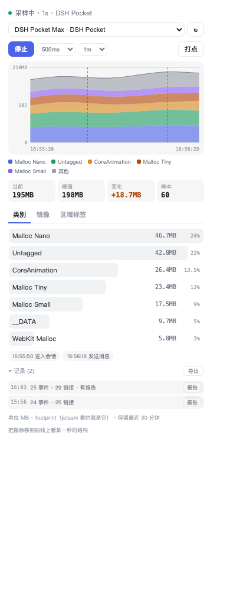
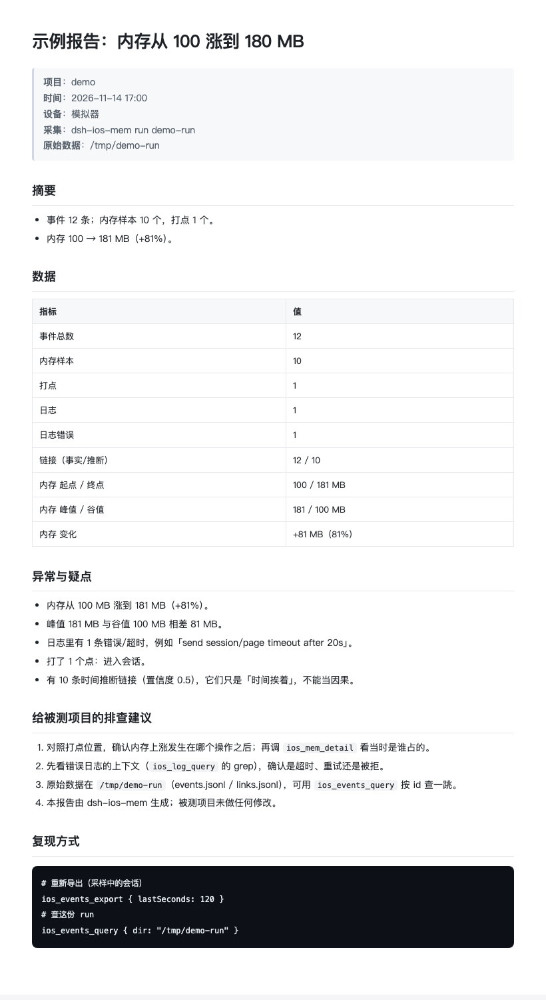

# dsh-ios-mem

> **一个 DeepSeek Harness（DSH）插件**，同时是一个 **stdio MCP server** 和一组命令行工具。
> 做三件事：**在模拟器上把能测的尽量测完**、**给真机做一次尽可能全的取证**、**把结论变成可交接的报告**。
>
> 对被测项目**只读**：不写它的代码、不写它的基线文档、不要求它加埋点。

---

## 1. 这个项目到底想解决什么

真机测试是一次高成本事件：设备、接线、装包、复现、抓数、传回。人不在电脑边时，这一天就废了。

所以目标不是「再做一个 Instruments」，而是：

| 目标 | 做法 |
| --- | --- |
| 装真机前尽量测完 | 模拟器上的内存曲线、类型下钻、日志、调用栈、pcap 解析、6 项体检 |
| 真机只跑一次 | 一次会话把内存/日志/崩溃/网络/栈都留下，离线分析（进行中） |
| 结论能交接 | 固定六段报告 + 带绝对路径的粘贴消息，开发拿去就能查 |
| 不碰被测项目 | 只读；临时文件写 `$TMPDIR` 并即删；报告写在本仓库 |

一句话：**把「感觉卡」变成「可比较的数字 + 可追溯的记录」。**

---

## 面板预览



> 用真实组件 + 模拟数据渲染的预览（我这边无法给需要登录的 DSH 页面截图）。
> 底部「记录」区列出历史 run，每行可以生成报告；「导出」在记录标题行右侧。

## 报告长什么样



> 示例数据（内存 100 → 181 MB）。报告固定六段：元信息 / 摘要 / 数据 / 异常与疑点 /
> 排查建议 / 复现方式；疑点与建议由规则算出，不是模型润色。

## 2. 三种用法

| 形态 | 谁用 | 入口 |
| --- | --- | --- |
| **DSH 插件** | DSH 里的 Agent / 右侧栏面板 | 安装后出现 15 个 `ios_*` 工具 + 「内存」面板 |
| **MCP server** | Claude Code / Cursor / 其他 harness | `node bin/mcp.mjs`（stdio） |
| **命令行** | 人 / CI | `npm run health`、`npm run report`、`npm run handoff` |

三者共用同一份内核（`core/`），工具行为不会分叉。

### 装进 DSH

```bash
# 在 DSH 里用 plugin_manager：install_bundle，target 指向本目录
# 之后新会话即可看到 ios_* 工具
```

### 接 MCP

```json
{
  "mcpServers": {
    "ios-mem": {
      "command": "node",
      "args": ["/Users/ruska/projects/dsh-plugins/dsh-ios-mem/bin/mcp.mjs"]
    }
  }
}
```

> 不要把 MCP 再挂回 DSH：DSH 已经有同名原生工具，挂上去只会多出两份工具和第二个采样进程。

---

## 3. 能力清单（15 个工具）

| 工具 | 平台 | 回答什么问题 |
| --- | --- | --- |
| `ios_mem_targets` | 模拟器 | 哪些模拟器开着、里面哪些 App 在跑（bundleId + pid） |
| `ios_mem_start` / `ios_mem_stop` | 模拟器 | 开始/停止实时采样（默认 1s，保留最近 30 分钟） |
| `ios_mem_status` | 模拟器 | 当前/峰值/均值/增量、涨速、top 类别 |
| `ios_mem_detail` | 模拟器 | 此刻按镜像、按区域标签的排行（谁在吃） |
| `ios_mem_mark` | 模拟器 | 在时间轴打点（配合报告对齐操作） |
| `ios_mem_record` | 真机 | 录一段内存曲线（Activity Monitor，约 1Hz），回放 |
| `ios_mem_types` | 真机 | 录一段 Allocations，按分配类型排行 live bytes（VM 预留单独算） |
| `ios_mem_launch` | 模拟器 | 启动 App |
| `ios_log_query` | 模拟器 | 最近 N 秒的统一日志（`log show --style json`），可 grep |
| `ios_hang_sample` | 模拟器 | 采 N 秒调用栈（`sample`），回答「卡住时在干什么」 |
| `ios_preflight` | 模拟器 | 装真机前体检：6 项 pass/warn/fail + report.md |
| `ios_net_analyze` | 文件 | 解析 pcap → HTTP 请求/响应/WS 帧对象（tshark） |
| `ios_events_export` | 模拟器 | 把样本/打点/日志导出成统一事件表 + 链接 |
| `ios_events_query` | 文件 | 给 id / rpcId 查一跳邻居；链接分事实与推断 |
| （非工具）报告/交接 | 命令行 | `npm run report` / `npm run handoff` |

平台说明：**模拟器**指 App 跑在 Mac 上的模拟器进程；**真机**指 USB 连接的物理设备；
**文件**指只处理本地文件，不需要设备。

---

## 4. 给 AI / Agent 的使用指南

### 4.1 典型工作流

```
装真机前    ios_preflight → 有问题先修
           ios_mem_start → 做操作 → ios_mem_mark("进入会话") → ios_mem_status
           → ios_log_query / ios_hang_sample 交叉看
           → ios_events_export → npm run report → npm run handoff
装真机后    ios_mem_record / ios_mem_types（真机录制）
有 pcap     ios_net_analyze → 对象进事件表
```

### 4.2 调用约定

1. **先 `ios_mem_targets`**，拿 `udid + bundleId`（或 pid）。不要猜 pid。
2. **pid 优先，bundleId 兜底**：传 `pid` 最快；只传 `bundleId` 会自动找。
3. **打点要贴着操作**：`ios_mem_start` → 操作 → `ios_mem_mark("刚做了什么")`。没有打点的曲线很难归因。
4. **别重复开采样**：同一时间只保留一个采样环；再次 `start` 会清空上一轮。
5. **真机工具会重新 launch App**（xctrace 的 `--launch`），别在操作中途调用。
6. **报告不要手写数字**：`ios_events_export` → `npm run report`，让规则算。

### 4.3 什么时候该用哪个

| 症状 | 先看 |
| --- | --- |
| 越用越卡 / 转圈 | `ios_hang_sample`（主线程栈）+ `ios_mem_status`（是否持续上涨） |
| 用一会儿闪退 | `ios_preflight`（崩溃项）+ 真机 `ios_mem_record`（是否接近 jetsam） |
| 消息没发出去 / 顺序乱 | `ios_log_query`（grep rpc/timeout）+ `ios_net_analyze`（pcap） |
| 不知道谁吃内存 | `ios_mem_detail`（模拟器）/ `ios_mem_types`（真机） |
| 改动后有没有退化 | `ios_mem_start` 跑同一场景，和上次报告比数量级 |

---

## 5. 数据模型：事件与链接

导出的一轮叫一个 **run**，落在 `docs/measurements/_runs/<时间>/`（不入库）。

```jsonc
// events.jsonl：一行一个对象实例
{"ts":"...","type":"mem_sample","id":"mem:1","sessionId":"run:...","rpcId":null,"pid":42,
 "attrs":{"totalMB":50.3,"top":"Malloc Nano"}}

// links.jsonl：一行一条链接实例
{"from":"mem:1","type":"contained_in","to":"run:...","method":"id","confidence":1}
{"from":"mem:21","type":"contained_in","to":"mark:1","method":"time","confidence":0.5}
```

**硬规则**：链接必须带 `method`（`id` = 有身份证的事实，`time` = 时间推断）和 `confidence`。
报告里两者分开展示；把推断当事实，比没有链接更糟。

---

## 6. 报告与交接

```bash
npm run report -- --run 20261114-1603 --project dsh-pocket-ios --title "内存采样"
npm run handoff -- --report docs/measurements/dsh-pocket-ios/<...>.md
```

- 报告固定六段：元信息 / 摘要 / 数据 / 异常与疑点 / 排查建议 / 复现。
- 交接消息带**绝对路径**，被测项目的 Agent 直接读文件，不用人肉转述。
- 目录约定：`docs/measurements/<项目>/<YYYY-MM-DD-HHMM>-<主题>.md`。

---

## 7. 代码健康扫描

```bash
npm run health -- --target /path/to/repo --project <slug> [--arch] [--coverage-json x.json] [--gate]
```

五个维度：文件规模（>400 行）、SwiftLint 结构规则、覆盖率（xccov）、未使用代码（Periphery）、
目标仓库自己的架构检查。Periphery 需要一次构建（`--periphery-project` + `--periphery-schemes`），
本机已装但**真跑未验证**。
`--gate` 任一不达标退出 1。对目标仓库只读。

---

## 8. 架构

```
core/
  util.js        无状态工具：exec、字节换算、region 拆分
  trace.js       xctrace：真机设备、sysmon 解析、录制编排
  targets.js     模拟器列表 / 运行中 App / 启动 App
  sampler.js     采样状态机（唯一有状态的东西）
  allocations.js 真机 Allocations 统计解析
  logs.js        统一日志查询 + 调用栈采样
  events.js      统一事件表 + 链接
  query.js       事件查询（一跳）
  net.js         pcap 解析（tshark fields）
  preflight.js   装真机前体检
  health.js      代码健康扫描规则
  report.js      run → 报告
  tools.js       15 个工具定义（DSH 与 MCP 共用）
index.js         DSH 插件入口（HTTP RPC + 工具）
client/          右侧栏面板源码（6 段，构建成 client.js）
bin/mcp.mjs      MCP server（stdio，无 SDK 依赖）
scripts/         报告、交接、健康扫描、客户端构建、检查点
```

`client.js` 是 `npm run build:client` 的生成物，**不要直接改**。

---

## 9. 边界（诚实）

1. **模拟器 ≠ 真机**：内存、性能、网络都不真实；真机进程无法被宿主 attach。
2. **真机实时做不到**：只能录制回放；类型下钻是录制结束时的快照。
3. **抓包需要权限**：`/dev/bpf0` 默认只有 root 可读；装 `wireshark-chmodbpf` 后可用。
4. **HTTPS 看不到内容**：pcap 只有握手与长度。
5. **日志可能含用户内容**：导出会截断到 200 字，但外发前仍要确认。
6. **工具给数字，判断还是人**：阈值是经验值，报告里的「疑点」可以被推翻。

---

## 10. 开发

```bash
npm test              # node --test，64 条
npm run build:client  # client/*.js → client.js
npm run health -- --target . --project dsh-ios-mem
```

规范：改动走 spec → 失败测试 → 实现 → 全量测试 → 检查点（`scripts/record-checkpoint.sh`）。

---

## 11. 目录速查

| 路径 | 内容 |
| --- | --- |
| `spec/` | 每轮改动的执行契约（背景/方案/测试/验收） |
| `docs/measurements/` | 报告（入库）与 run 原始数据（`_runs/`，不入库） |
| `docs/MCP.md` | MCP 接入细节 |
| `docs/articles/` | 给产品经理的说明文章 |
| `git-checkpoints.jsonl` | 每个提交的结构化记录 |
